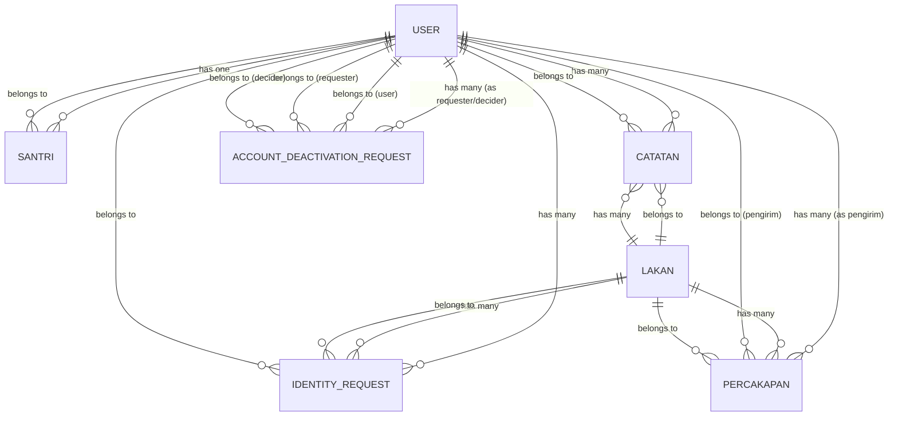

# Entity Relationship Diagram (ERD)

## Overview

This ERD describes the database schema for the Laravel application "api-santri". The system manages students (santris), reports (laporans), notes (catatans), conversations (percakapans), identity requests, and account deactivation requests.

## ER Diagram

## Entity Descriptions

### 1. `users` Table
- **Purpose**: Core user authentication and authorization
- **Key Fields**: id, name, email, role, is_active, must_change_password
- **Relationships**:
  - **hasOne** `santris` (one user has one student profile)
  - **hasMany** `catatans` (one user has many notes)
  - **hasMany** `percakapans` (one user has many conversations as pengirim/sender)
  - **hasMany** `identity_requests` (one user has many identity requests)
  - **hasMany** `account_deactivation_requests` (one user has many deactivation requests as requester/decider)

### 2. `santris` Table
- **Purpose**: Student profiles linked to users
- **Key Fields**: id, users_id (FK), nis, jenis_kelamin, telepon_ortu
- **Relationships**:
  - **belongsTo** `users` (student belongs to one user)

### 3. `laporans` Table
- **Purpose**: Report/laporan entries submitted by users
- **Key Fields**: id, users_id (FK), no_laporan (unique), kategori, isi, status, waktu, menyangkut_pimpinan
- **Relationships**:
  - **belongsTo** `users` (laporan belongs to one user)
  - **hasMany** `catatans` (one laporan has many notes)
  - **hasMany** `identity_requests` (one laporan has many identity requests)
  - **hasMany** `percakapans` (one laporan has many conversations)

### 4. `catatans` Table
- **Purpose**: Notes/comments related to reports or users
- **Key Fields**: id, users_id (FK), laporan_id (FK), catatan
- **Relationships**:
  - **belongsTo** `users` (note created by one user)
  - **belongsTo** `laporans` (note related to one laporan)

### 5. `percakapans` Table
- **Purpose**: Conversations/discussions related to reports
- **Key Fields**: id, users_id (pengirim/FK), laporan_id (FK), isi
- **Relationships**:
  - **belongsTo** `users` (conversation sent by one user/pengirim)
  - **belongsTo** `laporans` (conversation related to one laporan)

### 6. `identity_requests` Table
- **Purpose**: Identity verification requests related to reports
- **Key Fields**: id, laporan_id (FK), users_id (FK), alasan, bukti_path, status, dijawab
- **Relationships**:
  - **belongsTo** `laporans` (identity request related to one laporan)
  - **belongsTo** `users` (identity request submitted by one user)

### 7. `account_deactivation_requests` Table
- **Purpose**: Account deactivation requests
- **Key Fields**: id, user_id (FK), requested_by (FK), decided_by (FK), reason, status, decided_at
- **Relationships**:
  - **belongsTo** `users` (requesting user)
  - **belongsTo** `users` (requester who initiated the request)
  - **belongsTo** `users` (decider who approved/rejected the request)

## Key Design Notes

1. **Soft deletes & cascade**: Most relationships use `onDelete('cascade')` to maintain referential integrity
2. **Role-based access**: The `laporans` table has `menyangkut_pimpinan` flag to restrict certain categories
3. **Read tracking**: `laporans` table has per-role read columns (`santri_dibaca`, `pengurus_dibaca`, `pimpinan_dibaca`, `pengawas_dibaca`)
4. **Status tracking**: Reports have statuses: `baru`, `diproses`, `selesai` with escalation logic after 24 hours
5. **Identity verification**: Separate identity request flow linked to specific laporans

## Workflow Examples

- **Creating a report**: User → creates laporan → can have catatans, identity requests, and percakapans
- **Student management**: User → hasOne Santri profile → santri data is linked to user account
- **Identity verification**: Laporan → identity request → reviewed with biometric evidence (bukti_path)
- **Account deactivation**: Admin → creates request → user/decider processes it